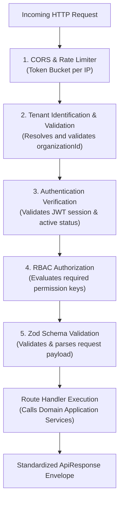

# Enterprise NGO Application — API Architecture & Route Handlers
**Framework**: Next.js 16 App Router Route Handlers (`src/app/api/v1/...`)  
**Format**: RESTful JSON over HTTPS  
**Validation**: Zod Schemas  

---

## 1. Middleware Pipeline Architecture

Every incoming API request is processed through an ordered, composable middleware pipeline before reaching domain business logic:



---

## 2. Standardized Response & Error Contracts

All endpoints return uniform response shapes defined in `src/lib/api-response.ts`:

### Success Response:
```json
{
  "success": true,
  "data": {
    "id": "don_8921a",
    "receiptNumber": "HH-80G-2026-00104",
    "amount": 5000,
    "status": "successful"
  },
  "meta": {
    "timestamp": "2026-11-18T23:00:00Z",
    "requestId": "req_c91f09"
  }
}
```

### Error Response:
```json
{
  "success": false,
  "error": {
    "code": "VALIDATION_FAILED",
    "message": "Invalid PAN Number provided for Section 80G tax receipt",
    "details": [
      { "field": "panOrTaxId", "message": "PAN must follow format: 5 letters, 4 digits, 1 letter" }
    ]
  },
  "meta": {
    "timestamp": "2026-11-18T23:00:00Z",
    "requestId": "req_c91f09"
  }
}
```

---

## 3. Master REST API Endpoint Catalog

### 3.1 Authentication & Sessions (`/api/v1/auth/`)
| Method | Endpoint | Access | Required Permission | Description |
| :--- | :--- | :---: | :---: | :--- |
| `POST` | `/api/v1/auth/register` | Public | None | Register new user; dispatches verification email |
| `POST` | `/api/v1/auth/login` | Public | None | Authenticate with email/password; returns session cookies |
| `POST` | `/api/v1/auth/logout` | Authenticated | None | Invalidates current session and clears HTTP-only cookies |
| `POST` | `/api/v1/auth/verify-email` | Public | None | Verifies email token and activates account |
| `POST` | `/api/v1/auth/forgot-password`| Public | None | Initiates password reset dispatch |
| `POST` | `/api/v1/auth/reset-password` | Public | None | Completes password reset using cryptographic token |
| `POST` | `/api/v1/auth/2fa/setup` | Authenticated | None | Generates TOTP secret and QR code URI |
| `POST` | `/api/v1/auth/2fa/verify` | Authenticated | None | Validates 6-digit TOTP code and enables 2FA |
| `GET` | `/api/v1/auth/sessions` | Authenticated | None | Lists active user device sessions |
| `DELETE`| `/api/v1/auth/sessions/:id` | Authenticated | None | Remotely terminates a specific device session |

---

### 3.2 Donations & Giving (`/api/v1/donations/`)
| Method | Endpoint | Access | Required Permission | Description |
| :--- | :--- | :---: | :---: | :--- |
| `POST` | `/api/v1/donations` | Public | None | Creates a donation order with Razorpay/Stripe details |
| `POST` | `/api/v1/donations/verify` | Public | None | Verifies gateway payment signature and finalizes receipt |
| `GET` | `/api/v1/donations` | Authenticated | `donations.view_all` | Paginated search across all donations (by date, PAN, campaign) |
| `GET` | `/api/v1/donations/me` | Authenticated | `donations.view_own` | Retrieves authenticated donor's giving history |
| `GET` | `/api/v1/donations/:id/receipt`| Public / Auth | None / Own | Generates/downloads official 80G PDF receipt |
| `POST` | `/api/v1/donations/:id/refund` | Authenticated | `donations.refund` | Authorizes and initiates refund via payment gateway |

---

### 3.3 Payment Gateway Webhooks (`/api/v1/webhooks/`)
| Method | Endpoint | Access | Security | Description |
| :--- | :--- | :---: | :---: | :--- |
| `POST` | `/api/v1/webhooks/razorpay` | Public | Webhook Secret Header | Processes Razorpay `payment.captured` & `refund.processed` |
| `POST` | `/api/v1/webhooks/stripe` | Public | Stripe-Signature Header | Processes Stripe `payment_intent.succeeded` & charges |

---

### 3.4 Projects & Milestones (`/api/v1/projects/`)
| Method | Endpoint | Access | Required Permission | Description |
| :--- | :--- | :---: | :---: | :--- |
| `GET` | `/api/v1/projects` | Public | None | Lists active and featured projects with funding progress |
| `GET` | `/api/v1/projects/:slug` | Public | None | Detailed project overview, budget utilization, milestones |
| `POST` | `/api/v1/projects` | Authenticated | `projects.manage` | Creates a new field deployment project |
| `PATCH`| `/api/v1/projects/:id` | Authenticated | `projects.manage` | Updates project details, funding goals, team assignments |
| `POST` | `/api/v1/projects/:id/milestones` | Authenticated | `projects.manage` | Adds a new project milestone |
| `PATCH`| `/api/v1/projects/:id/milestones/:mId`| Authenticated | `tasks.update_assigned` | Updates milestone progress or marks completed |

---

### 3.5 Volunteers & Service Hours (`/api/v1/volunteers/`)
| Method | Endpoint | Access | Required Permission | Description |
| :--- | :--- | :---: | :---: | :--- |
| `POST` | `/api/v1/volunteers/apply` | Public | None | Submits volunteer application wizard |
| `GET` | `/api/v1/volunteers` | Authenticated | `volunteers.view` | Lists volunteer applications with status filtering |
| `PATCH`| `/api/v1/volunteers/:id/status` | Authenticated | `volunteers.manage` | Approves or rejects volunteer application |
| `POST` | `/api/v1/volunteers/hours` | Authenticated | `volunteers.log_hours`| Logs field hours with activity notes |
| `PATCH`| `/api/v1/volunteers/hours/:id/approve` | Authenticated | `volunteers.manage` | Approves logged volunteer service hours |

---

### 3.6 Certificates & Public Ledger (`/api/v1/certificates/`)
| Method | Endpoint | Access | Required Permission | Description |
| :--- | :--- | :---: | :---: | :--- |
| `GET` | `/api/v1/certificates/verify/:code` | Public | None | Public verification check for certificate number or QR code |
| `POST` | `/api/v1/certificates` | Authenticated | `certificates.issue` | Issues official credential to volunteer/donor/member |
| `POST` | `/api/v1/certificates/:id/revoke` | Authenticated | `certificates.revoke` | Revokes certificate with mandatory justification |

---

### 3.7 Financial Reports & Compliance (`/api/v1/reports/`)
| Method | Endpoint | Access | Required Permission | Description |
| :--- | :--- | :---: | :---: | :--- |
| `GET` | `/api/v1/reports/transparency` | Public | None | Lists public audited reports, FCRA filings, annual reviews |
| `POST` | `/api/v1/reports/transparency` | Authenticated | `compliance.manage` | Uploads new statutory report document |
| `GET` | `/api/v1/reports/export/form10be` | Authenticated | `reports.export_financial`| Exports Section 80G Form 10BE tax ledger in CSV/Excel |
| `GET` | `/api/v1/reports/export/donations` | Authenticated | `reports.export_financial`| Exports raw financial transactions ledger |

---

### 3.8 Audit Ledger & Security (`/api/v1/audit/`)
| Method | Endpoint | Access | Required Permission | Description |
| :--- | :--- | :---: | :---: | :--- |
| `GET` | `/api/v1/audit/logs` | Authenticated | `audit_logs.view` | Paginated query across immutable security events |
| `GET` | `/api/v1/audit/roles` | Authenticated | `roles.manage` | Retrieves the organization's dynamic RBAC matrix |
| `PATCH`| `/api/v1/audit/roles/:role` | Authenticated | `roles.manage` | Customizes permission policy for an organizational role |
