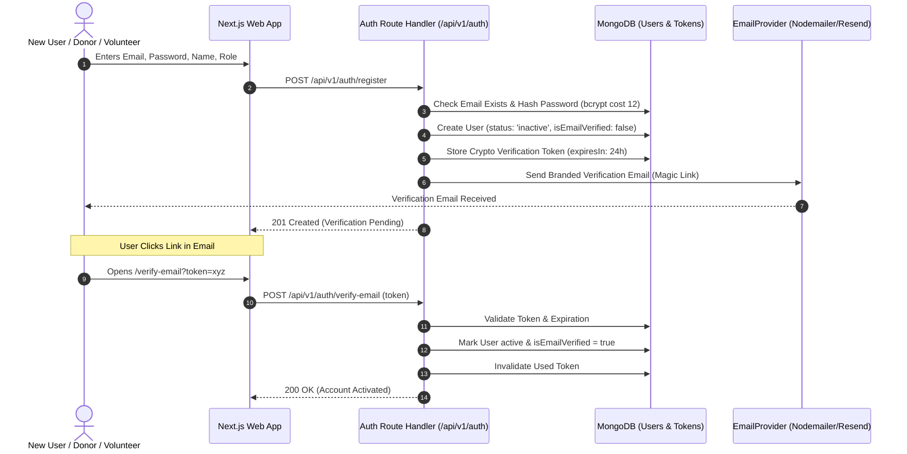
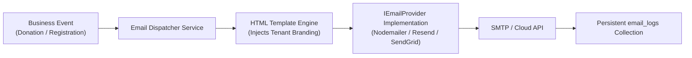

# Enterprise NGO Application — Authentication & Email Architecture
**Project Name**: HopeHorizon / Vikas NGO Ecosystem  
**Scope**: Cryptographic Authentication, Secure Session Management & Transactional Email Subsystem  

---

## 1. Authentication & Identity Lifecycle



### 1.1 Password Security & Storage
- **Algorithm**: `bcryptjs` with salt round cost factor `12`.
- **Validation**: Minimum 8 characters, at least 1 uppercase letter, 1 lowercase letter, 1 number, and 1 special symbol. Enforced via Zod schema before hitting the hashing service.

### 1.2 Session Management Strategy
- **Token Mechanism**: Dual-token pattern using JSON Web Tokens (JWT) signed via `jose`:
  - **Access Token**: Short-lived (15 minutes), holds user ID, organization ID, assigned role, and permissions array.
  - **Refresh Token**: Long-lived (7 days), stored encrypted in the database `sessions` collection and transmitted exclusively via `HttpOnly`, `Secure`, `SameSite=Strict` cookies.
- **Session Revocation**: The `/dashboard` Security Center allows users and admins to remotely terminate active sessions across other devices by setting `isRevoked: true` on the corresponding session document.

### 1.3 Two-Factor Authentication (2FA)
- Implemented using **Time-Based One-Time Passwords (TOTP)** compliant with RFC 6238 via `otplib`.
- Setup flow generates a base32 secret and an `otpauth://` URI, rendered into an SVG QR code using `qrcode.react`.
- Recovery mechanism provides 8 single-use cryptographically hashed backup codes stored in the `users.twoFactor.backupCodes` array.

---

## 2. Transactional Email System Architecture

### 2.1 Pluggable Provider Interface (`src/integrations/email/email.adapter.ts`)
```typescript
export interface EmailAttachment {
  filename: string;
  content: Buffer | string;
  contentType?: string;
}

export interface EmailOptions {
  to: string | string[];
  subject: string;
  htmlContent: string;
  textContent?: string;
  attachments?: EmailAttachment[];
  tags?: string[];
}

export interface IEmailProvider {
  sendEmail(options: EmailOptions): Promise<{ success: boolean; messageId?: string; error?: string }>;
  send80GReceiptEmail(donorEmail: string, donorName: string, receiptNumber: string, pdfBuffer: Buffer): Promise<boolean>;
}
```

### 2.2 Reusable Branded Email Templates
All transactional emails use a unified, mobile-responsive HTML layout with the NGO's official branding (Organization Name, Statutory Registration Numbers, Emerald accent header, verified footer, and unsubscribed preferences).

#### Master Template Inventory:
1. `verify-email.html`: Account confirmation link with single-click magic authentication.
2. `password-reset.html`: Time-sensitive password reset link with IP address and security advisory.
3. `donation-receipt-80g.html`: Official thank-you letter detailing the 50% tax exemption under Section 80G(5)(vi), attaching the signed Form 10BE PDF receipt.
4. `volunteer-status-update.html`: Notification of application status change (`approved` / `scheduled orientation`).
5. `member-welcome-pass.html`: Membership welcome dispatch with an embedded high-resolution digital pass and QR code.
6. `event-ticket-qr.html`: Event RSVP confirmation containing check-in time, venue map link, and individual attendee check-in QR code.
7. `admin-security-alert.html`: Sent to super admins upon unrecognized login locations, multiple failed auth attempts, or manual database exports.

---

## 3. Email Dispatch & Audit Trail



### `email_logs` Collection Schema:
```typescript
interface IEmailLogSchema {
  _id: ObjectId;
  organizationId: ObjectId;
  recipientEmail: string;
  templateId: string;
  subject: string;
  status: 'queued' | 'sent' | 'failed' | 'bounced';
  messageId?: string;
  errorMessage?: string;
  attemptCount: number;
  sentAt?: Date;
  createdAt: Date;
}
```
- **Retry Policy**: Failed transactional dispatches undergo exponential backoff (retry after 1m, 5m, 15m) before alerting administrators.
- **Zero Secret Leakage**: SMTP passwords and API keys are stored strictly in server environment variables (`SMTP_PASSWORD`, `RESEND_API_KEY`) and are never exposed in Next.js public bundles (`NEXT_PUBLIC_`).
