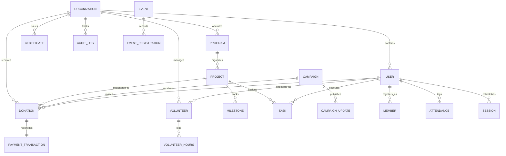

# Enterprise NGO Application — Database Architecture & Data Models
**Engine**: MongoDB (v6.0+) / Mongoose (v9.7+)  
**Pattern**: Tenant-Scoped Collections with Compound Indexing and Schema-Level Isolation  

---

## 1. Architectural Principles & Isolation Pattern

To deliver multi-tenant data safety, every non-system collection enforces:
1. **Mandatory Tenant Discriminator**: Every document contains `organizationId: { type: Schema.Types.ObjectId, ref: 'Organization', required: true, index: true }`.
2. **Compound Indexing**: Queries are compounded on `{ organizationId: 1, <filterField>: 1, createdAt: -1 }` to guarantee sub-millisecond lookups while eliminating cross-tenant leakage.
3. **Soft Deletion Pattern**: Critical records (donations, projects, users) use `isDeleted: { type: Boolean, default: false }` and `deletedAt: { type: Date, default: null }` rather than physical removal.
4. **Audit Metadata**: Automated schema timestamps (`createdAt`, `updatedAt`) plus `createdBy` / `updatedBy` user references.

---

## 2. Master Entity-Relationship Diagram



---

## 3. Core Schema Specifications

### 3.1 Organization & Security Domain

#### `organizations` (Tenants)
```typescript
interface IOrganizationSchema {
  _id: ObjectId;
  name: string;                            // 'Vikas Foundation for Human Development'
  slug: string;                            // 'vikas-foundation' (Unique)
  customDomain?: string;                   // 'vikas-ngo.org'
  logo: string;
  contactEmail: string;
  contactPhone: string;
  headquartersAddress: string;
  statutory: {
    panNumber: string;                     // Organization PAN
    section80GNumber: string;              // 80G Approval Reference
    section12ANumber: string;              // 12A Registration Reference
    fcraNumber?: string;                   // FCRA Regulatory Number
    darpanId?: string;                     // NITI Aayog Portal ID
    taxExemptionPercentage: number;        // Default 50%
  };
  settings: {
    currencyCode: string;                  // 'INR'
    currencySymbol: string;                // '₹'
    defaultLocale: string;                 // 'en'
    autoSendReceipts: boolean;
    maintenanceMode: boolean;
  };
  isActive: boolean;
  createdAt: Date;
  updatedAt: Date;
}
// Indexes: { slug: 1 }, { customDomain: 1 }
```

#### `users` (Identity & Roles)
```typescript
interface IUserSchema {
  _id: ObjectId;
  organizationId: ObjectId;                // Multi-tenant reference
  name: string;
  email: string;                           // Lowercase, trimmed
  passwordHash: string;                    // bcrypt (cost 12)
  role: UserRole;                          // 13 roles
  departmentId?: ObjectId;
  phone?: string;
  designation?: string;
  avatar?: string;
  panNumber?: string;                      // Optional encrypted personal PAN for 80G
  status: 'active' | 'inactive' | 'suspended';
  isEmailVerified: boolean;
  emailVerifiedAt?: Date;
  twoFactor: {
    enabled: boolean;
    secret?: string;                       // TOTP secret
    backupCodes?: string[];
  };
  lastLoginAt?: Date;
  createdAt: Date;
  updatedAt: Date;
}
// Compound Indexes: { organizationId: 1, email: 1 } (Unique), { organizationId: 1, role: 1 }
```

#### `sessions` (Active Device Sessions)
```typescript
interface ISessionSchema {
  _id: ObjectId;
  userId: ObjectId;
  organizationId: ObjectId;
  tokenHash: string;                       // SHA-256 of session token
  device: string;                          // 'macOS Chrome 130'
  ipAddress: string;
  lastActiveAt: Date;
  expiresAt: Date;                         // TTL Index
  isRevoked: boolean;
}
// Indexes: { tokenHash: 1 }, { expiresAt: 1 } (TTL)
```

---

### 3.2 Giving & Financial Domain

#### `donations` (Tax-Exempt & General Contributions)
```typescript
interface IDonationSchema {
  _id: ObjectId;
  organizationId: ObjectId;
  donorId?: ObjectId;                      // Linked if authenticated
  donorName: string;
  donorEmail: string;
  donorPhone?: string;
  panOrTaxId?: string;                     // Mandatory for Section 80G
  isAnonymous: boolean;
  amount: number;
  currency: 'INR' | 'USD';
  donationType: 'one-time' | 'recurring';
  frequency?: 'monthly' | 'quarterly' | 'annual';
  campaignId?: ObjectId;
  projectId?: ObjectId;
  paymentGateway: 'razorpay' | 'stripe' | 'cashfree' | 'bank_transfer';
  gatewayOrderId?: string;
  gatewayPaymentId?: string;
  transactionId: string;
  status: 'pending' | 'successful' | 'failed' | 'refunded';
  receiptNumber: string;                   // E.g. HH-80G-2026-00492
  taxExemptionEligible: boolean;           // True if PAN provided & domestic INR
  receiptPdfUrl?: string;                  // Object storage link
  notes?: string;
  refundDetails?: {
    refundedAt: Date;
    reason: string;
    authorizedBy: ObjectId;
  };
  createdAt: Date;
  updatedAt: Date;
}
// Compound Indexes: { organizationId: 1, receiptNumber: 1 } (Unique), { organizationId: 1, status: 1, createdAt: -1 }
```

#### `payment_transactions` (Raw Gateway Logs)
```typescript
interface IPaymentTransactionSchema {
  _id: ObjectId;
  organizationId: ObjectId;
  donationId: ObjectId;
  gateway: 'razorpay' | 'stripe';
  gatewayOrderId: string;
  gatewayPaymentId?: string;
  gatewaySignature?: string;
  rawWebhookPayload?: Record<string, unknown>;
  verified: boolean;
  createdAt: Date;
}
```

---

### 3.3 Programs, Projects & Campaigns

#### `projects` (Field Deployments)
```typescript
interface IProjectSchema {
  _id: ObjectId;
  organizationId: ObjectId;
  programId: ObjectId;
  title: string;
  slug: string;
  category: string;
  description: string;
  objectives: string[];
  location: string;
  startDate: Date;
  endDate: Date;
  status: 'draft' | 'planned' | 'active' | 'on_hold' | 'completed' | 'archived';
  budget: number;
  fundingGoal: number;
  amountRaised: number;
  beneficiariesCount: number;
  managerId: ObjectId;
  teamMemberIds: ObjectId[];
  images: string[];
  impactStats: Array<{ label: string; value: string }>;
  isDeleted: boolean;
  createdAt: Date;
  updatedAt: Date;
}
// Compound Indexes: { organizationId: 1, slug: 1 } (Unique), { organizationId: 1, status: 1 }
```

#### `milestones`
```typescript
interface IMilestoneSchema {
  _id: ObjectId;
  organizationId: ObjectId;
  projectId: ObjectId;
  title: string;
  description: string;
  targetDate: Date;
  status: 'pending' | 'in_progress' | 'completed';
  progressPercentage: number;
  completedAt?: Date;
}
```

#### `campaigns` (Fundraising Appeals)
```typescript
interface ICampaignSchema {
  _id: ObjectId;
  organizationId: ObjectId;
  title: string;
  slug: string;
  description: string;
  category: string;
  targetAmount: number;
  raisedAmount: number;
  donorCount: number;
  startDate: Date;
  endDate: Date;
  image: string;
  status: 'draft' | 'scheduled' | 'active' | 'completed' | 'cancelled';
  beneficiaryInfo: string;
  isUrgent: boolean;
  updates: Array<{
    title: string;
    content: string;
    date: Date;
    author: string;
    image?: string;
  }>;
  createdAt: Date;
  updatedAt: Date;
}
```

---

### 3.4 Community, Volunteers & Members

#### `volunteers`
```typescript
interface IVolunteerSchema {
  _id: ObjectId;
  organizationId: ObjectId;
  userId?: ObjectId;
  name: string;
  email: string;
  phone: string;
  location: string;
  skills: string[];
  interests: string[];
  availability: string;
  experience: string;
  status: 'applied' | 'under_review' | 'approved' | 'active' | 'inactive' | 'rejected';
  assignedProjectIds: ObjectId[];
  totalHoursLogged: number;
  joinedDate: Date;
  createdAt: Date;
  updatedAt: Date;
}
// Compound Indexes: { organizationId: 1, email: 1 }, { organizationId: 1, status: 1 }
```

#### `volunteer_hours`
```typescript
interface IVolunteerHoursSchema {
  _id: ObjectId;
  organizationId: ObjectId;
  volunteerId: ObjectId;
  projectId?: ObjectId;
  date: Date;
  hours: number;
  activityDescription: string;
  status: 'pending' | 'approved' | 'rejected';
  approvedBy?: ObjectId;
  createdAt: Date;
}
```

#### `members` (General Assembly)
```typescript
interface IMemberSchema {
  _id: ObjectId;
  organizationId: ObjectId;
  userId?: ObjectId;
  memberId: string;                        // Unique identifier E.g. HH-MBR-2026-104
  name: string;
  email: string;
  phone: string;
  tier: 'Youth Ambassador' | 'Annual Supporter' | 'Lifetime Patron' | 'Corporate Member';
  status: 'active' | 'expired' | 'pending';
  startDate: Date;
  expiryDate: Date;
  renewalDate?: Date;
  contributionAmount: number;
  digitalCardQr: string;
  createdAt: Date;
  updatedAt: Date;
}
```

---

### 3.5 Governance, Trust & Communications

#### `certificates` (Public Verification Registry)
```typescript
interface ICertificateSchema {
  _id: ObjectId;
  organizationId: ObjectId;
  certificateNumber: string;               // Unique: HH-VOL-2026-8821
  verificationCode: string;                // Cryptographic check code E.g. VER-9281A
  recipientName: string;
  recipientEmail: string;
  certificateType: 'Volunteer Service' | 'Participation' | 'Appreciation' | 'Training Completion' | 'Honorary Membership';
  title: string;
  description: string;
  issuedBy: string;
  issuerRole: string;
  issueDate: Date;
  qrData: string;                          // Verification URL
  status: 'valid' | 'revoked';
  revocationReason?: string;
  createdAt: Date;
}
// Compound Indexes: { certificateNumber: 1 } (Unique), { verificationCode: 1 } (Unique)
```

#### `audit_logs` (Immutable Security Ledger)
```typescript
interface IAuditLogSchema {
  _id: ObjectId;
  organizationId: ObjectId;
  actorId: ObjectId;
  actorName: string;
  actorRole: string;
  action: string;                          // E.g. 'DONATION_REFUND', 'ROLE_POLICY_UPDATE'
  resource: string;                        // E.g. 'donations', 'users'
  resourceId?: string;
  details: string;
  ipAddress: string;
  userAgent?: string;
  timestamp: Date;
}
// Compound Indexes: { organizationId: 1, timestamp: -1 }, { organizationId: 1, resource: 1 }
```

#### `newsletter_subscribers`
```typescript
interface INewsletterSubscriberSchema {
  _id: ObjectId;
  organizationId: ObjectId;
  email: string;
  fullName?: string;
  phone?: string;
  interest: 'donor' | 'volunteer' | 'both';
  frequency: 'weekly' | 'monthly' | 'quarterly';
  status: 'active' | 'unsubscribed';
  source: string;                          // E.g. 'homepage_footer', 'urgent_campaign'
  leadTags: string[];
  consentGiven: boolean;
  subscribedAt: Date;
}
// Compound Indexes: { organizationId: 1, email: 1 } (Unique)
```
