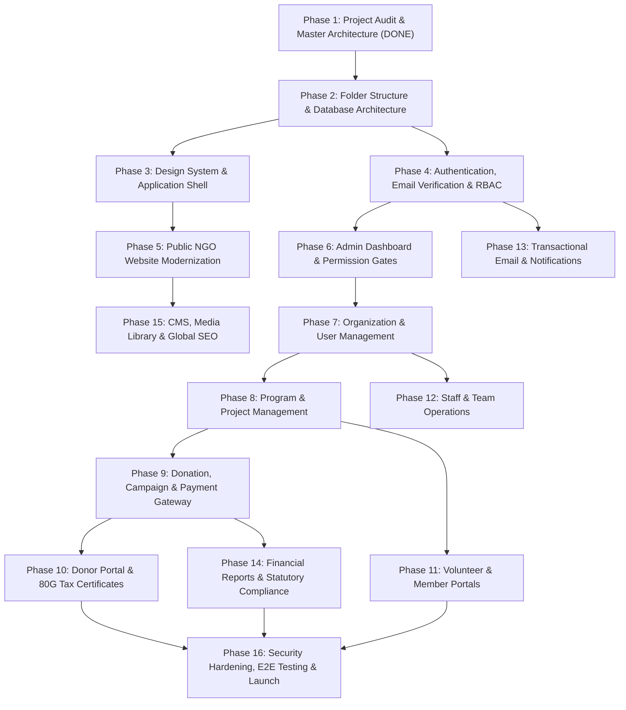

# Enterprise NGO Application — 16-Phase Development Roadmap
**Project Name**: HopeHorizon / Vikas NGO Ecosystem  
**Execution Strategy**: Dependency-Aware Phased Rebuild  

---

## 1. Master Phased Implementation Matrix

---

## 2. Phase-by-Phase Execution Details

### Phase 1: Existing Project Audit & Master Architecture (CURRENT)
- **Focus**: Exhaustive inspection of repository assets, architecture blueprinting, 13-role RBAC definition, multi-tenant strategy.
- **Deliverables**: Ten comprehensive architecture documents in `docs/`.
- **Status**: ✅ **COMPLETED**.

---

### Phase 2: Enterprise Folder Structure & Database Architecture (NEXT)
- **Focus**: Reorganizing into a feature-based hybrid directory structure and creating the Mongoose persistence foundation.
- **Dependencies**: Phase 1.
- **Key Deliverables**:
  - Implementation of Mongoose schemas in `src/models/` for all collections (`organizations`, `users`, `donations`, `projects`, `campaigns`, `volunteers`, `certificates`, `audit_logs`).
  - Creation of global tenant-isolation Mongoose plugin.
  - Database seed automation script to populate initial organizations and demo users from `mockDatabase.ts`.
  - Type-safe database connection validation in Next.js initialization.

---

### Phase 3: Design System & Branding Tokens
- **Focus**: Polishing the Tailwind CSS v4 design token foundation and standardizing all 25+ design system components.
- **Dependencies**: Phase 1.
- **Key Deliverables**:
  - Consistent token scales in `src/lib/design-tokens.ts` for colors, elevations, radii, and typography.
  - Refactored reusable components (`DataTable`, `KpiCard`, `Modal`, `Button`, `FormField`).
  - Mobile bottom navigation and responsive mega-menu optimizations.

---

### Phase 4: Authentication, Email Verification & RBAC
- **Focus**: Full server-side authentication with secure session management and role-based route protection.
- **Dependencies**: Phase 2, Phase 3.
- **Key Deliverables**:
  - Implementation of Next.js Route Handlers: `/api/v1/auth/register`, `/login`, `/logout`, `/verify-email`, `/reset-password`.
  - JWT creation and verification using `jose` with HTTP-only cookies.
  - TOTP two-factor authentication setup and verification.
  - Server-side authorization middleware (`authorizeRequest`).
  - Nodemailer SMTP adapter implementation for verification and password reset emails.

---

### Phase 5: Public NGO Website Modernization
- **Focus**: Wiring public routes to Server Components with SSR caching and dynamic metadata.
- **Dependencies**: Phase 2, Phase 3.
- **Key Deliverables**:
  - High-conversion landing page with live database statistics.
  - Dynamic cause/program pages (`/programs`, `/projects/[slug]`, `/campaigns/[slug]`).
  - OpenGraph image generation and metadata optimization for social sharing.
  - Zod-validated newsletter lead capture wired to persistent collection.

---

### Phase 6: Admin Dashboard & Permission Gates
- **Focus**: Building the authenticated central administration suite.
- **Dependencies**: Phase 4, Phase 5.
- **Key Deliverables**:
  - Central `/dashboard` layout with role-aware sidebar navigation.
  - Admin Overview with real-time KPI aggregations.
  - Dynamic Security Audit Center rendering the active 13-role permission matrix.
  - Client-side `<PermissionGate>` and server-side route guards on all administrative actions.

---

### Phase 7: Organization & User Management
- **Focus**: Managing multi-tenant profiles and staff lifecycle.
- **Dependencies**: Phase 6.
- **Key Deliverables**:
  - Tenant organization profile editor (statutory registrations, logos, bank details).
  - User management CRUD table with status toggling (`active`, `suspended`).
  - Role assignment modal with self-escalation prevention.
  - Department management and team lead assignments.

---

### Phase 8: Program & Project Management
- **Focus**: Field operations, funding targets, and progress tracking.
- **Dependencies**: Phase 6, Phase 7.
- **Key Deliverables**:
  - Project creation and milestone tracker wizard.
  - Real-time funding progress calculation based on reconciled donations.
  - Beneficiary count tracking by geographical location.
  - Field updates timeline with photo attachments.

---

### Phase 9: Donation, Campaign & Payment Management
- **Focus**: 80G tax-exempt giving and live payment gateway reconciliation.
- **Dependencies**: Phase 4, Phase 8.
- **Key Deliverables**:
  - Live Razorpay and Stripe checkout integration.
  - Webhook handlers (`/api/v1/webhooks/razorpay`, `/api/v1/webhooks/stripe`) with cryptographic signature validation.
  - Automated generation of statutory Form 10BE receipt numbers.
  - Refund processing workflow with mandatory audit trail.

---

### Phase 10: Donor Portal & Tax Portfolios
- **Focus**: Dedicated self-service portal for financial supporters.
- **Dependencies**: Phase 9.
- **Key Deliverables**:
  - Donor giving portfolio displaying lifetime contributions and causes funded.
  - Interactive Section 80G tax savings calculator.
  - One-click historical PDF receipt re-downloading.
  - Recurring pledge management and cancellation.

---

### Phase 11: Volunteer & Member Portals
- **Focus**: Grassroots mobilization and governance engagement.
- **Dependencies**: Phase 6, Phase 8.
- **Key Deliverables**:
  - Volunteer hour logger with celebration animations and admin approval flow.
  - Verifiable service certificate claims with QR codes.
  - Member governance portal with digital pass and AGM voting records.
  - Public certificate verification endpoint (`/verify-certificate`).

---

### Phase 12: Staff & Team Operations
- **Focus**: Internal operational coordination.
- **Dependencies**: Phase 6, Phase 7.
- **Key Deliverables**:
  - Task assignment board with priority tags and due dates.
  - Daily attendance clock-in/out with location tagging.
  - Leave request submission and managerial approval workflow.
  - Direct field update dispatches to urgent campaigns.

---

### Phase 13: Transactional Email & Notification Center
- **Focus**: Complete automated communications ecosystem.
- **Dependencies**: Phase 4, Phase 9, Phase 11.
- **Key Deliverables**:
  - Automated 80G receipt email delivery with dynamically rendered PDF attachments.
  - Volunteer application status notifications.
  - Event RSVP confirmations with individual QR tickets.
  - Persistent `email_logs` ledger with delivery tracking and failure retry policy.

---

### Phase 14: Financial Reports & NGO Compliance
- **Focus**: Statutory compliance and financial governance.
- **Dependencies**: Phase 9, Phase 10.
- **Key Deliverables**:
  - Section 80G Form 10BE annual export in official CSV format.
  - Foreign Contribution Regulation Act (FCRA) audit ledger.
  - Transparency repository document uploader with categorized fiscal years.
  - Immutable platform audit log explorer with filtering by actor, action, and date.

---

### Phase 15: CMS, Media Library & Global SEO
- **Focus**: Storytelling, content publishing, and discoverability.
- **Dependencies**: Phase 5, Phase 6.
- **Key Deliverables**:
  - Rich text CMS article editor for field blogs and press releases.
  - Media asset manager supporting image and document uploads to cloud storage.
  - Automated XML sitemap generation, structured JSON-LD schemas for non-profits.
  - Multi-language dictionary expansion.

---

### Phase 16: Security Hardening, E2E Testing & Production Deployment
- **Focus**: Enterprise resilience, penetration resistance, and continuous delivery.
- **Dependencies**: All preceding phases.
- **Key Deliverables**:
  - Comprehensive unit test coverage using Vitest.
  - Critical path end-to-end test suites using Playwright (Donation checkout, Auth, 80G receipt gen).
  - Accessibility audit with `@axe-core/playwright` (WCAG 2.1 AA).
  - Production environment configuration, Dockerfile, and Vercel deployment pipeline.
