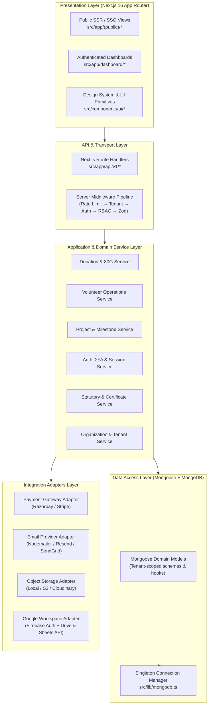
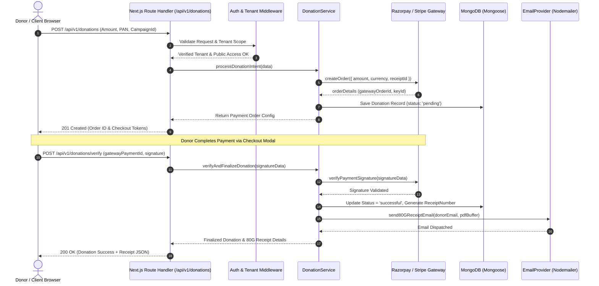

# Enterprise NGO Application — Master Technical Architecture Blueprint
**Project Name**: HopeHorizon / Vikas NGO Ecosystem  
**Architecture Pattern**: Layered Clean Architecture with Pluggable Integration Adapters  
**Runtime**: Next.js 16 (App Router) / React 19 / TypeScript / Node.js 20+  

---

## 1. Architectural Philosophy & Design Principles

The platform follows a **Layered Clean Architecture** designed to strictly isolate user interface components, application business logic, data access abstractions, and third-party external integrations.



### Core Design Rules:
1. **Unidirectional Dependency Flow**: Dependencies strictly point inward. Domain business logic never imports from Next.js route handlers or React components.
2. **Server-Enforced Authorization**: The UI reflects user permissions for presentation only; every API Route Handler independently validates tenant identity, user session, and specific permission keys before executing business operations.
3. **Pluggable Adapter Boundaries**: External cloud vendors (payments, email, storage) are wrapped behind strict TypeScript interface contracts. Swapping an email vendor from Nodemailer to Resend requires zero changes to the underlying application services.
4. **Tenant Isolation**: Every database write and read requires an explicit `organizationId` filter validated from the cryptographically verified session token.

---

## 2. Layer-by-Layer Architectural Breakdown

### 2.1 Presentation Layer (Next.js 16 App Router)
- **Server Components (RSC) by Default**: Static informational views (About, FAQ, Mission, Legal) utilize React Server Components for optimal SEO, low bundle weight, and rapid First Contentful Paint (FCP).
- **Interactive Client Islands**: Interactive components (Donation form, Volunteer hour logger, Persona switcher, Modals, Google Sheets Hub) use `'use client'` directives with localized state.
- **Global Modal System**: Cross-cutting modals (Auth, Profile, Search, Donate, Receipt, Certificate Viewer) are registered in a single top-level `GlobalModals` shell driven by Zustand (`src/lib/ui-store.ts`), eliminating prop-drilling.
- **Design Tokens**: Centralized in `src/lib/design-tokens.ts`, defining semantic colors (Emerald primary for social impact, Sky secondary, Amber humanitarian accents, Slate neutrals), mathematical spacing scales, and subtle shadow elevations.

### 2.2 API & Transport Layer (`src/app/api/v1/`)
- **Standardized Response Protocol**: All route handlers serialize responses through `src/lib/api-response.ts`:
  ```typescript
  export interface ApiResponse<T = unknown> {
    success: boolean;
    data?: T;
    error?: {
      code: string;
      message: string;
      details?: unknown;
    };
    meta?: {
      timestamp: string;
      requestId: string;
      pagination?: {
        page: number;
        limit: number;
        total: number;
        totalPages: number;
      };
    };
  }
  ```
- **Error Handling Hierarchy**: Standardized exceptions in `src/lib/error-handler.ts` (`AppError`, `ValidationError`, `UnauthorizedError`, `ForbiddenError`, `NotFoundError`) are trapped by top-level try/catch blocks and converted to JSON error envelopes with proper HTTP status codes.

### 2.3 Application & Domain Service Layer
Encapsulates all NGO business workflows:
- **`DonationService`**: Validates PAN format, initiates payment gateway orders, verifies transaction signatures, generates sequential 80G receipt numbers, and schedules email delivery.
- **`VolunteerService`**: Processes applications, transitions volunteer statuses (`applied` → `approved`), validates logged hours against active project schedules, and awards service certificates upon reaching milestone hours.
- **`ComplianceService`**: Validates 80G Form 10BE threshold criteria, tracks Section 12A renewal dates, segregates FCRA foreign funding lines, and cryptographically signs verification payloads for certificates.
- **`TenantService`**: Manages organization provisioning, statutory profile configuration, and multi-tenant domain mapping.

### 2.4 Data Access Layer (`Mongoose + MongoDB`)
- **Connection Singleton (`src/lib/mongodb.ts`)**: Caches the Mongoose connection promise in `global._mongooseConn` to prevent pool exhaustion during Next.js Hot Module Replacement (HMR).
- **Tenant Discriminator**: All collection schemas enforce `organizationId: { type: Schema.Types.ObjectId, ref: 'Organization', required: true, index: true }`.
- **Compound Indexes**: Indexed specifically for frequent operational queries:
  - Donations: `{ organizationId: 1, status: 1, createdAt: -1 }`
  - Tax Receipts: `{ organizationId: 1, taxExemptionEligible: 1, panOrTaxId: 1 }`
  - Volunteers: `{ organizationId: 1, status: 1, email: 1 }`
  - Projects: `{ organizationId: 1, status: 1, slug: 1 }`

### 2.5 Pluggable Integration Layer
Located under `src/integrations/`:
1. **Payment Adapter (`IPaymentGateway`)**: Supports `createOrder`, `verifyPayment`, and `fetchPaymentDetails`. Provides pluggable implementations for Razorpay, Stripe, and manual bank transfer logging.
2. **Email Adapter (`IEmailProvider`)**: Supports `sendEmail` and `send80GReceiptEmail`. Generates branded HTML emails and attaches dynamically rendered PDF receipts.
3. **Storage Adapter (`IStorageProvider`)**: Supports `uploadFile`, `deleteFile`, and `getSignedUrl` for storing audit reports, certificates, and media assets.
4. **Google Workspace Service (`src/services/googleWorkspace.ts`)**: Direct browser-to-Google OAuth via Firebase Auth, enabling export and syncing of Donations, Volunteers, and Projects into Google Sheets.

---

## 3. End-to-End Request Lifecycle



---

## 4. Cross-Cutting Concerns & Security Specifications

### 4.1 Structured Logging & PII Redaction
Implemented via `src/lib/logger.ts` using Pino:
- Sensitive fields (`password`, `token`, `panNumber`, `creditCard`, `authorization`, `secret`) are automatically redacted before stream output.
- Log levels dynamically adhere to `LOG_LEVEL` environment variable (`debug`, `info`, `warn`, `error`).

### 4.2 Security Best Practices
- **Authentication**: JWTs with short expiry (15m) paired with rotating refresh tokens stored in HTTP-only, SameSite=Strict cookies.
- **Two-Factor Authentication (2FA)**: Time-based One-Time Passwords (TOTP) compliant with RFC 6238 via `otplib`.
- **Cross-Site Scripting (XSS)**: Automatic React JSX escaping, strict Content Security Policy (CSP) headers, and DOMPurify sanitization on CMS articles.
- **Rate Limiting**: In-memory token bucket / Redis rate limiting on sensitive authentication and payment verification routes.
- **Audit Trails**: Every administrative modification, refund, status update, and statutory report export is recorded in the immutable `audit_logs` collection.
