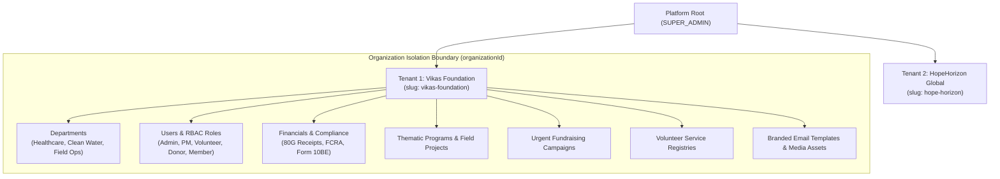

# Enterprise NGO Application — Multi-Tenant Architecture
**Project Name**: HopeHorizon / Vikas NGO Ecosystem  
**Model**: Logical Multi-Tenancy with Tenant Discriminator & Strict Isolation Boundaries  

---

## 1. Multi-Tenant Organizational Hierarchy



---

## 2. Tenant Resolution Strategy

Requests dynamically resolve the active tenant through three priority mechanisms:

1. **Custom Domain**: Evaluated from the `Host` header (e.g., `www.vikas-ngo.org` matched against `organizations.customDomain`).
2. **Subdomain**: Evaluated from `Host` header (e.g., `vikas.hopehorizon.app` matched against `organizations.slug`).
3. **Session Token / Context Fallback**: In authenticated dashboard environments or mobile API consumption, the verified JWT session payload provides the cryptographically validated `organizationId`.

### Security Rule:
**Never trust `organizationId` passed directly in the HTTP query string or JSON request body.**  
The tenant identity is resolved strictly by the server middleware from the verified host or signed session cookie, preventing tenant-spoofing attacks.

---

## 3. Database Layer Isolation (Mongoose Pre-Hook Pattern)

To guarantee that developers cannot accidentally omit an `organizationId` filter, a global Mongoose plugin automatically injects the tenant boundary on all query and mutation hooks:

```typescript
// Example: src/lib/mongoose-tenant-plugin.ts
import { Schema } from 'mongoose';

export function tenantIsolationPlugin(schema: Schema) {
  schema.add({
    organizationId: {
      type: Schema.Types.ObjectId,
      ref: 'Organization',
      required: true,
      index: true
    }
  });

  // Automatically scope find queries
  schema.pre(/^find/, function (next) {
    const currentTenantId = (this as any)._tenantId;
    if (currentTenantId) {
      this.where({ organizationId: currentTenantId });
    }
    next();
  });

  // Automatically scope insert/create queries
  schema.pre('save', function (next) {
    if (!this.organizationId && (this as any)._tenantId) {
      this.organizationId = (this as any)._tenantId;
    }
    next();
  });
}
```

---

## 4. Tenant-Specific Customizations

| Customization Domain | Isolated Tenant Assets | Storage / Resolution Location |
| :--- | :--- | :--- |
| **Visual Branding** | Primary logo, favicon, hero images, brand color tokens (Emerald vs. Sapphire vs. Coral) | `organizations.settings.branding`, injected via CSS variables |
| **Statutory Registrations** | PAN number, 80G Approval Number, 12A Number, FCRA Registration, Darpan Portal ID | `organizations.statutory.*`, rendered dynamically on official receipts |
| **Currencies & Localization** | Base currency (`INR`, `USD`), symbol (`₹`, `$`), allowed language packs (`en`, `hi`, `bn`) | `organizations.settings.currencyCode` |
| **Payment Gateways** | Tenant-specific Razorpay Key ID/Secret, Stripe Publishable/Secret Keys | Encrypted server credentials vault scoped by `organizationId` |
| **Email Sender Identity** | Custom `From` address (e.g. `donations@vikas-ngo.org`), custom SMTP credentials | Encrypted in `organizations.settings.emailConfig` |
| **Document Storage** | Uploaded audit reports, volunteer certificates, media assets | S3 bucket path partition: `s3://ngo-vault/{organizationId}/...` |

---

## 5. Tenant Provisioning & Deactivation Workflow

### 5.1 Onboarding Sequence
1. `SUPER_ADMIN` creates a new organization record via the Platform Admin Console, specifying organization name, legal registration details, and initial slug.
2. System seeds the organization's initial `SystemSettings` and default RBAC policy.
3. System sends an automated onboarding invitation to the primary `ADMIN` email address with a time-limited setup magic link.
4. The new administrator configures their password, uploads organizational logos, verifies statutory 80G numbers, and inputs payment gateway credentials.

### 5.2 Suspension / Maintenance Sequence
- If an organization's subscription expires or security auditing detects anomalies, `isActive` is set to `false`.
- Public requests to that tenant's domain are greeted by a graceful informational maintenance page without leaking backend data.
- API route handlers immediately return `403 Tenant Suspended` error envelopes.
