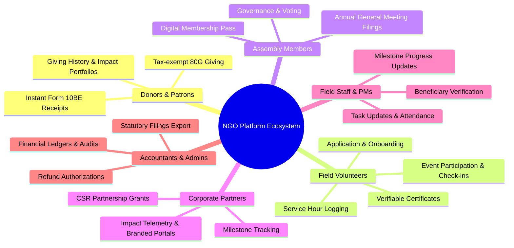

# Enterprise NGO Application — Product Requirements Document (PRD)
**Project Name**: HopeHorizon / Vikas NGO Ecosystem  
**Target Architecture**: Enterprise Multi-Tenant NGO Management & Digital Engagement Application  
**Version**: 2.0.0-foundation  

---

## 1. Product Vision & Objectives

The primary objective is to transform the existing HopeHorizon / Vikas NGO platform from a mock-data-driven digital presence into a production-grade, enterprise-scale NGO Operating System. 

The platform bridges three foundational pillars:
1. **Public Transparency & Fundraising**: Engaging donor journeys, story-driven impact reports, verified 80G tax exemptions, and verifiable public ledgers.
2. **Operational Field Orchestration**: Volunteer dispatch, hours logging, project milestones, team member task assignments, and event attendance check-ins.
3. **Governance & Statutory Compliance**: Multi-tenant isolation, 9-tier RBAC, automated Section 80G Form 10BE generation, FCRA contribution segregation, NITI Aayog Darpan tracking, and immutable audit logs.

---

## 2. Stakeholder Personas & Core Use Cases

### 2.1 External Stakeholders
- **Individual Donors**: Require transparent giving channels (INR & foreign currencies), instant statutory 80G receipts, recurring pledge options, and clear impact reporting showing where money is deployed.
- **Corporate CSR Partners**: Need structured grant management, corporate partnership tier tracking (Platinum, Gold, Silver), project co-sponsorship tracking, and branded impact telemetry.
- **Volunteers & Interns**: Need a streamlined onboarding path, skill-based project assignment, real-time service hour logging, and cryptographically verifiable service certificates.
- **General Assembly Members**: Need governance participation records, voting status, digital membership QR passes, and annual renewal alerts.
- **Public & Regulators**: Require tamper-evident public access to audited annual statements, Section 12A/80G validity records, FCRA returns, and certificate verification tools.

### 2.2 Internal Stakeholders
- **Super Administrators**: Complete multi-tenant oversight, tenant onboarding, global security monitoring, integration credentials, and immutable platform-wide audit access.
- **NGO Administrators & Directors**: Daily operational oversight, campaign approvals, user lifecycle management, donation reconciliation, and organization settings.
- **Project & Field Managers**: Managing field initiatives, assigning team tasks, tracking beneficiary counts, and posting real-time field progress updates.
- **Accountants & Compliance Officers**: Generating Form 10BE tax ledgers, monitoring FCRA foreign inflows, managing expense vouchers, and authorizing donation refunds.
- **Communications & Content Teams**: Managing CMS stories, publishing press releases, media asset organization, and running email newsletter broadcasts.

---

## 3. Detailed Functional Requirements

### 3.1 Public Portal & Storytelling
- **High-Impact Landing Page**: 25+ modular sections highlighting active emergency appeals, key metrics (People Helped, Clean Water Deployed, Audit Score), action areas, and community stories.
- **Comprehensive About Suite**: Dedicated sub-routes for Organization Story, Mission & Vision, Core Values, Leadership, Board of Directors, Team Members, Awards, and Founder’s Message.
- **Dynamic Projects & Programs**: Exploration of causes with dedicated detail views (`/projects/[id]`, `/campaigns/[id]`) showing funding progress, budget utilization, and impact stats.
- **Public Verification Ledger**: Public route `/verify-certificate` enabling anyone to verify the authenticity of volunteer/donor certificates using certificate numbers or QR verification codes.
- **Transparency Hub**: Public archive of annual audit reports, Form 10BE filings, FCRA returns, and governance documents available for inspection and PDF download.
- **Multi-Language Accessibility**: Real-time language switching supporting English (`en`), Hindi (`hi`), and Bengali (`bn`) with RTL/LTR design tokens.

### 3.2 Donation & 80G Tax-Exempt Giving Engine
- **Giving Modes**: Support for one-time donations and recurring automated pledges (monthly, quarterly, annual).
- **Dual-Currency Processing**: Seamless selection between Indian Rupees (`INR`) and foreign currencies (`USD`), automatically routing domestic funds to standard accounts and international funds to FCRA-designated accounts.
- **Statutory 80G Receipt Automation**:
  - Mandatory collection of Donor PAN / Tax ID for donations claiming tax exemption.
  - Automatic calculation of the 50% eligible deduction under Section 80G(5)(vi).
  - Generation of unique receipt serial numbers conforming to statutory patterns (`HH-80G-YYYY-XXXXX`).
  - Instant in-browser PDF download, print-optimized formatting, and automated email dispatch with PDF attachment.
- **Payment Gateway Boundaries**: Pluggable integration supporting Razorpay (UPI, Netbanking, Cards), Stripe (International Cards), and direct Bank Wire Transfers.
- **Refund & Reconciliation**: Accountant/Admin ability to authorize, review, and execute refunds with mandatory audit reasoning.

### 3.3 Volunteer & Member Lifecycle Management
- **Volunteer Onboarding Wizard**: Application form collecting contact details, city, skill sets, availability, and specific project interests.
- **Application Review Workflow**: Admin dashboard to filter, review, approve, or reject volunteer applications with automated email notifications.
- **Volunteer Portal**:
  - Secure self-service workspace.
  - Interactive service hour logging with date, duration, and activity description.
  - Earned credentials showcase displaying issued service certificates with QR codes.
- **Member Management**:
  - Multi-tier membership structure (`Youth Ambassador`, `Annual Supporter`, `Lifetime Patron`, `Corporate Member`).
  - Automated digital membership card generation with personalized QR code and expiry tracking.
  - Renewal notices and governance voting participation logs.

### 3.4 Project, Campaign & Field Operations
- **Project Hierarchy**: Programs decompose into specific Projects, which in turn contain Milestones and Staff Tasks.
- **Milestone Tracking**: Project managers can set target dates, track progress percentages, and mark milestones completed from the field.
- **Urgent Appeals & Live Updates**: Field staff can upload photos and publish real-time campaign dispatches to keep donors engaged during humanitarian operations.
- **Beneficiary Tracking**: Real-time aggregation of direct and indirect beneficiaries across all active project locations.

### 3.5 Communications, Email & Lead Engine
- **Zod-Validated Newsletter Engine**: Lead capturing with strict email, phone, frequency, and interest (Donor, Volunteer, Both) schema validation.
- **Automated Transactional Emails**:
  - Donor Thank You & 80G Receipt Delivery (PDF attached).
  - Volunteer Application Acknowledgment & Status Approval.
  - Member Onboarding & Digital Pass Issuance.
  - Password Reset & Magic Link Verification.
  - Event Registration Tickets with Check-in QR.
- **Audit Logs for Communications**: Recording all outbound emails, delivery statuses, and recipient interactions in a persistent `email_logs` collection.

---

## 4. Non-Functional Requirements (NFRs)

| Category | Requirement | Metric / Specification |
| :--- | :--- | :--- |
| **Performance** | Page Load & Core Web Vitals | LCP < 1.8s, FID < 100ms, CLS < 0.05 on standard 4G connections. SSR caching for public routes. |
| **Security** | Authentication & Session Integrity | HTTP-only, Secure, SameSite cookies. Passwords hashed with bcrypt (cost factor 12). 2FA via TOTP. |
| **Confidentiality** | Sensitive PII & Financial Data | Donor PANs and banking identifiers encrypted at rest; automatic redaction in application logs. |
| **Reliability** | Uptime & Error Resilience | 99.9% uptime target. Error Boundaries around all client modules. Graceful fallback on network drops. |
| **Scalability** | Multi-Tenancy & Database | Compound indexes on all Mongoose queries keyed by `organizationId`. Connection pool management via singleton. |
| **Compliance** | Legal & Tax Governance | Conformance to Indian Income Tax Act (Section 80G, 12A), FCRA Act 2010, and NITI Aayog guidelines. |
| **Accessibility** | Usability & Inclusivity | WCAG 2.1 Level AA compliance. Fully navigable via keyboard, screen-reader-friendly aria attributes. |
| **Maintainability** | Code Cleanliness & Architecture | Strict TypeScript, Zero `any` in production paths, feature-based modular folder structure. |
