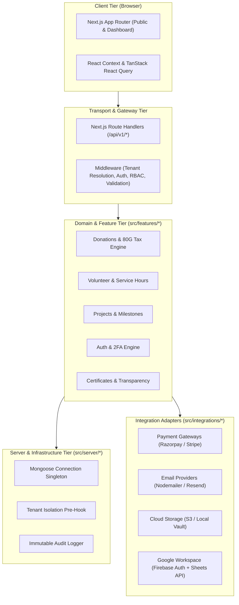

# Enterprise NGO Platform — System Architecture Specification
**Platform**: HopeHorizon / Vikas NGO Ecosystem  
**Architecture Style**: Modular Monolith with Layered Clean Architecture & Pluggable Adapters  

---

## 1. Architectural Style & Design Principles

The application is engineered as a **Modular Monolith** applying **Domain-Driven Design (DDD)** and **Layered Clean Architecture** principles:

---

## 2. Core Architectural Pillars

### 2.1 Separation of Routing vs. Business Logic
- `src/app/`: The Next.js App Router is purely a **Routing & Layout Shell**. Files such as `page.tsx`, `layout.tsx`, and `route.ts` must remain thin orchestrators (typically under 40 lines of code) that parse route parameters, execute middleware, and delegate immediately to feature components or domain services.
- `src/features/`: Encapsulates all domain-specific components, state, hooks, validation rules, and business calculations.

### 2.2 Server/Client Boundary Isolation
- **Server-Only Infrastructure**: Everything under `src/server/` is restricted to server runtimes. It may never be imported by components annotated with `'use client'`.
- **Client Components**: Located in feature modules or shared UI primitives, annotated with `'use client'`, handling local interactivity, animations, and form inputs.

### 2.3 Pluggable Adapter Isolation
- Cloud service dependencies (payment processing, transactional email, file storage) are decoupled via interfaces defined in `src/integrations/`. This guarantees that swapping third-party providers requires zero edits to business logic in `src/features/`.

### 2.4 Multi-Tenant Data Scoping
- Every database interaction is scoped to an `organizationId`. Server middleware resolves the tenant from the verified host or signed session cookie, ensuring zero data leakage between independent organizations on the platform.
