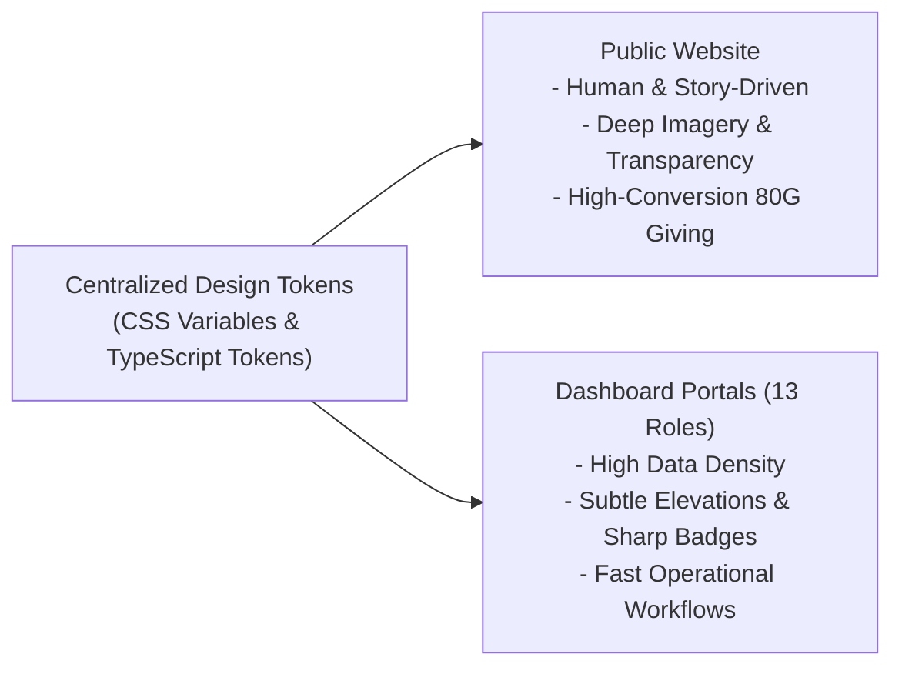

# Enterprise NGO Design System & UI/UX Foundation
**Platform**: HopeHorizon / Vikas NGO Ecosystem  
**Target Architecture**: Scalable, Multi-Tenant Design Foundation for 10–20 Developers  
**Design Principles**: Trust, Humanity, Transparency, Accountability & Social Impact  

---

## 1. Visual Philosophy & Identity

The design system establishes a unified visual language tailored specifically for an international humanitarian and non-governmental organization:
- **Humanitarian Trust**: Deep Emerald (`#087F5B`) represents social growth, environmental resilience, and integrity.
- **Global Hope**: Sky Blue (`#2787C7`) highlights clean water security, healthcare, and global partnerships.
- **Humanitarian Warmth & Urgency**: Warm Amber (`#E9A23B`) communicates urgent appeals, disaster relief, and active community mobilization.
- **Restraint & Dignity**: Avoids superficial AI-generated gimmicks, excessive neon gradients, and blinding glassmorphism in favor of calm, high-contrast, nature-inspired surfaces.

---

## 2. Multi-Surface Design Consistency

The design system bridges two distinct but complementary user experiences:



### Consistency Across 14 User Surfaces:
1. Public NGO Website (`/`, `/about`, `/projects`, `/campaigns`, `/donate`, `/transparency`)
2. Authentication & Onboarding Pages (`/login`, `/donor-register`, `/volunteer`)
3. Super Admin Dashboard (Multi-tenant governance)
4. Admin Dashboard (NGO operational control)
5. Executive Director Dashboard (Strategic KPI summaries)
6. Manager Dashboard (Cross-project coordination)
7. Project Manager Dashboard (Field deployments & milestones)
8. Accountant Dashboard (Financial ledgers & Form 10BE tax exports)
9. Communications Dashboard (Emergency appeals & press dispatches)
10. Content Editor Dashboard (CMS stories & media gallery)
11. Team Member Dashboard (Tasks & attendance clocking)
12. Volunteer Service Hub (Hour submissions & service certificates)
13. Donor Impact Portfolio (Giving history & tax deduction calculators)
14. Assembly Member Portal (Digital membership pass & governance standing)

---

## 3. Design System Architecture

```text
src/
├── styles/
│   ├── tokens.css             # Semantic CSS Custom Properties (Light/Dark)
│   ├── themes.css             # Multi-tenant and high-contrast theme overrides
│   └── utilities.css          # Printable media styles & utility classes
├── lib/
│   └── design-tokens.ts       # Typed TypeScript tokens for colors, typography, spacing
├── context/
│   └── ThemeContext.tsx       # Theme provider supporting Light, Dark & System
└── components/
    └── ui/                    # Standardized reusable design primitives
```
