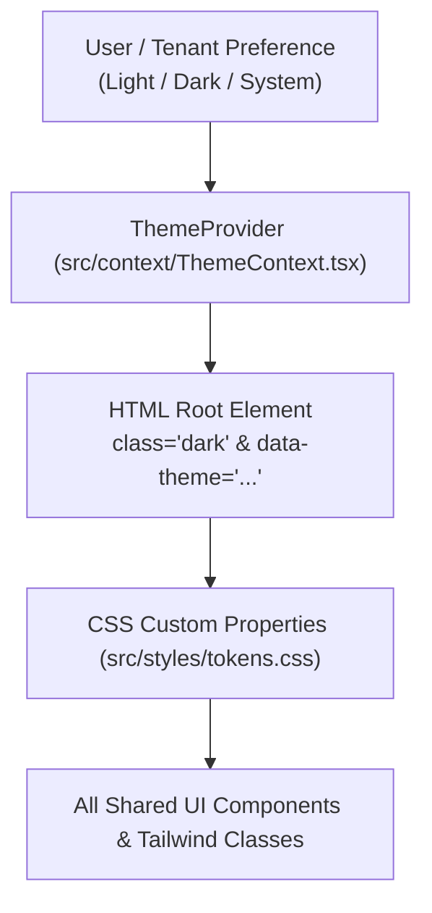

# Enterprise NGO Design System — Theme & Dark Mode Guidelines
**Platform**: HopeHorizon / Vikas NGO Ecosystem  
**Architecture**: CSS Custom Properties with Context Provider & System Auto-Detection  

---

## 1. Theme Architecture Overview

The theming engine supports **Light Mode**, **Dark Mode**, and **System Preference Detection**, backed by multi-tenant organization color themes:



---

## 2. Using the Theme Engine in Code

### Toggling Theme in React:
```tsx
import { useTheme } from '@/context/ThemeContext';
import { ThemeToggle } from '@/components/ui';

// Drop-in toggle button
<ThemeToggle variant="icon" />

// Or using hook directly
const { theme, resolvedTheme, setTheme, toggleTheme } = useTheme();
```

---

## 3. Multi-Tenant Theme Customizations

Tenants can apply organization-specific palette accents via `data-theme` on the root element or sub-containers:

1. **`data-theme="emerald"`** (Default): Nature Emerald (`#087F5B`) for general welfare, agriculture, and education trusts.
2. **`data-theme="sky"`**: Ocean Blue (`#2787C7`) for clean drinking water, sanitation, and marine ecology foundations.
3. **`data-theme="amber"`**: Warm Amber (`#E9A23B`) for disaster relief, emergency humanitarian aid, and poverty eradication.
4. **`data-theme="high-contrast"`**: Maximum accessibility mode with pure blacks, pure whites, and enhanced 7:1 borders.
