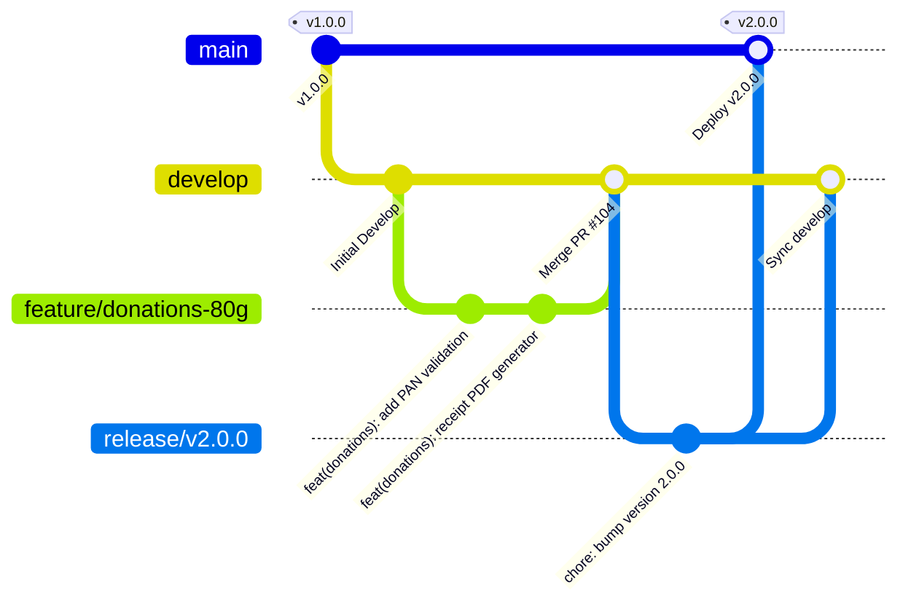

# Enterprise NGO Platform — Git Workflow & Branching Strategy
**Platform**: HopeHorizon / Vikas NGO Ecosystem  
**Model**: GitFlow with Feature Branch Isolation for Multi-Developer Teams  

---

## 1. Branch Strategy

### Branch Roles:
- **`main`**: Protected production branch. Code here is deployed directly to production.
- **`develop`**: Primary continuous integration branch. All feature branches merge here via reviewed Pull Requests.
- **`feature/<domain>-<description>`**: Isolated feature branch created from `develop` (e.g. `feature/donations-pan-verification`).
- **`fix/<issue-description>`**: Bug fix branch created from `develop`.
- **`hotfix/<emergency-fix>`**: Critical fix branch branched directly from `main`.

---

## 2. Commit Message Standards (Conventional Commits)

Format: `<type>(<scope>): <subject>`

### Allowed Types:
- `feat`: A new user-facing or platform feature.
- `fix`: A bug fix.
- `refactor`: Code reorganization with no functional or API changes.
- `docs`: Documentation updates only.
- `test`: Adding or updating test cases.
- `chore`: Build tooling, dependency bumps, or config adjustments.

### Examples:
- `feat(donations): add section 80G Form 10BE receipt generation`
- `fix(auth): prevent session expiration race condition in token refresh`
- `docs(architecture): document module boundary rules for multi-dev setup`
